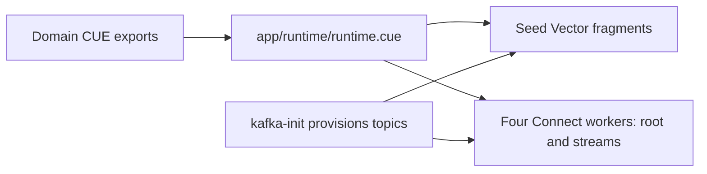

# Pipeline runtime

Vector seed and the four Connect workers extend published `teyfix/*` images. `Dockerfile` selects explicit catalog revisions, adds jq for seed's download script, and copies the broker-tools artifact into the separate one-shot topic provisioner. Application CUE, mappings, credentials and topic definitions stay in this repository.

Each worker mounts `app/` read-only at `/app` and one configuration from `config/`. `app/runtime/runtime.cue` adapts the existing domain exports to the shared renderer's filename/object interface: seed emits flat Vector fragments, while Connect emits native `root.yaml` resources/metrics and `streams/*.yaml`. Apply shared [CUE generation](/../memory/.agents/skills/languages/cue/references/configuration.md) and the [pipeline image contract](/../containers/svc/pipeline-dev/README.md) for validation, activation, dependency watching, reload/restart, readiness and shutdown.

`kafka-init` remains the sole topic provisioner. It exports declarations directly from `shared/tmdb`, deduplicates topic names, and uses native rpk create/configure/partition operations. It does not rerender unrelated workers. Provisioning errors prevent dependent workers from starting. Redpanda remains the existing Kafka broker.

Seed downloads live under `.cache/tmdb/exports`, mounted at `/downloads`; its native Vector state lives under `.state/pipeline/data/seed`. Seed explicitly enables [Vector's native environment interpolation](https://vector.dev/docs/reference/environment_variables/) for its consumer-owned configuration (disabled by default since Vector 0.57). Its environment contains the configured broker and download settings. Download scheduling uses the integer interval in `app/seed/download.cue`. The Kafka topic template retains a static `tmdb.` prefix for Vector's namespace confinement, using generated `meta.topic_suffix` for routing while retaining the full `meta.topic` in messages.

Connect state uses `.state/pipeline/data/<worker>`, and native engine JSON logs use `.state/pipeline/logs/<worker>`. The external Vector collector reads those logs rather than relying on Docker stdout for engine output. Compose keeps existing service aliases; seed exposes its metrics on 9598 and API on 8686, and Connect exposes metrics/readiness on 4195 inside the project network.

Workers watch `app/`, including imported Bloblang mappings, under the shared image contract. Changing a worker's `config/*.yaml` requires a container restart.

Movie, show and season enrichment use TMDB's `append_to_response=watch/providers`. The normalizer unwraps the returned country map under `data["watch/providers"]` without retaining the old `results` wrapper. Watch-provider PostgreSQL tables are not implemented; other movie/show/season ingestion stays unchanged.

The old `seed_tmdb`/`seed_vector` named volumes are not deleted by this migration. If retained downloads exist in an old seed volume, copy them into `.cache/tmdb/exports` before starting seed; keep the source volume until the copy is verified. No old seed-download volume was present on the development host during adoption. `docker compose down -v` does not delete the new bind-mounted `.state` paths. Stop the affected services before explicitly resetting their scoped state, and preserve `.cache/`.

Run `bun run pipeline:check` from the project root to build the consumer extensions, check the native broker tools/CUE declarations, and validate all five rendered workers without starting their engines or contacting upstream APIs. CI runs the same command with development example inputs and fixed two-CPU/two-GiB limits for normalize and ingest. This checks configuration compatibility; the end-to-end Kafka/TMDB/PostgreSQL flow is a separate integration check.
